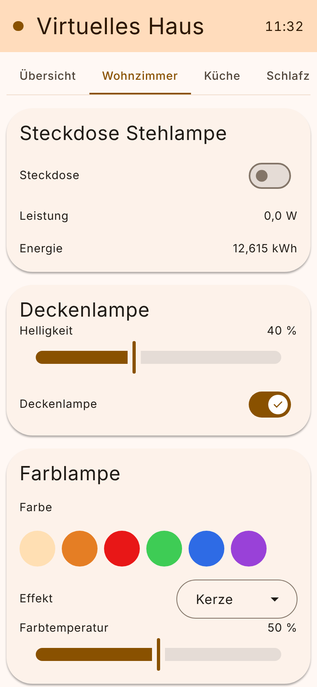
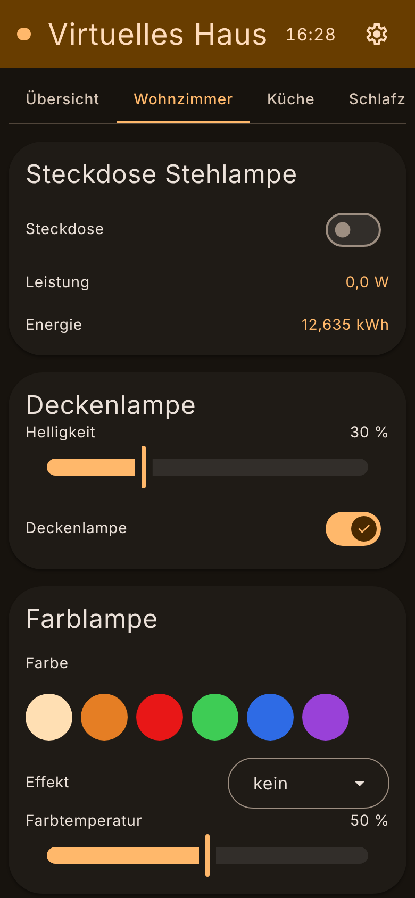
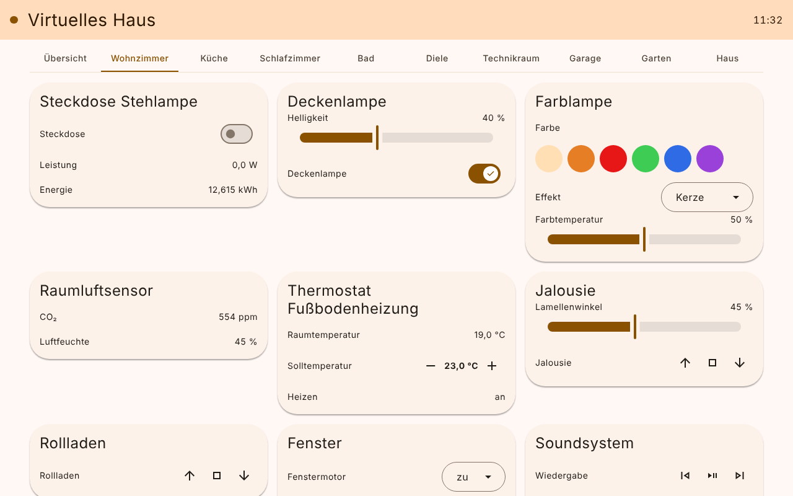

# smart-home-dashboard-theme-material

**Ansicht „material“** für das [Smart-Home-Dashboard](https://github.com/Michdo93/Smart-Home-Dashboard) (openHAB 5): das Smart-Home-Dashboard in Material Design 3.

**Online-Demo:** <https://michdo93.github.io/smart-home-dashboard-theme-material-live-demo/> ([Repo](https://github.com/Michdo93/smart-home-dashboard-theme-material-live-demo))

| Smartphone hell | Smartphone dunkel |
|---|---|
|  |  |



## Idee

[Material Design 3](https://m3.material.io) („Material You“) leitet alle Farben einer Oberfläche aus einer einzigen Grundfarbe ab. Diese Ansicht nutzt das: Aus der Markenfarbe in `config.js` (`brandColor`, Voreinstellung `#c97a00`) entstehen automatisch die Töne für Kopfzeile, Karten, Schalter und Regler – hell und dunkel. Umgesetzt mit [Beer CSS](https://www.beercss.com), ganz ohne Build-Schritt.

## Mehrwert

- **Markenfarbe rein, fertiges Design raus:** ideal für Kundendemos – eine Zeile in `config.js` genügt.
- **Android-nahe Optik**, die Smartphone-Nutzer sofort verstehen.
- **Kein doppelter Code:** Controller, Store und Texte kommen aus dem Dashboard.
- **Gestaltungsentscheidung statt Zwang:** Material kennt keinen Farbkreis – Farben werden aus sechs festen Tönen gewählt.

## Funktionen

Aus dem Dashboard übernommen (`../js/`):

- **Einstellungen** (Zahnrad): Sprache (de, en, fr), Grundfarbe (Marke aus `config.js`, Blau, Grün, Pink, Violett), hell/dunkel/wie System. Gemerkt im Browser; Sprache und Modus gelten auch für die anderen Ansichten.
- **Sperrbildschirm** (Schloss) mit der PIN aus `config.js` (`lock`).
- **Verlaufsdiagramme**: Ein Klick auf einen Zahlenwert zeigt 6 h, 24 h oder 7 Tage (braucht Persistence, siehe Buch).
- **Bilder** (`Image`-Items wie die Karte des Saugroboters) als Bild.

Die eigenen Gerätemodule (Lampe, Thermostat, Wetter) sind der Standard-Ansicht vorbehalten.

## Installation

Voraussetzung: das [Smart-Home-Dashboard](https://github.com/Michdo93/Smart-Home-Dashboard) ist installiert (Standard: `/etc/openhab/html/dashboard`) – ab der Fassung mit `js/controller.js`.

```bash
git clone https://github.com/Michdo93/smart-home-dashboard-theme-material
cd smart-home-dashboard-theme-material
sudo ./install.sh                       # kopiert den Ordner material/ ins Dashboard
sudo ./install.sh /pfad/zum/dashboard   # anderer Ordner
```

Aufruf: `http://<openhab>:8080/static/dashboard/material/` – mit `?room=gVH_Kueche` startet es in einem Raum, mit `?lang=en` auf Englisch. Entfernen: `sudo ./uninstall.sh`.

Die Ansicht liest Adresse, Token, oberste Gruppe und Übersicht aus der `config.js` des Dashboards und nutzt dessen `lib/openhab.min.js`.

## Markenfarbe einstellen

In der `config.js` des Dashboards:

```js
brandColor: "#0b6bcb",   // Grundfarbe für Material Design 3
```

Enthält [Beer CSS](https://github.com/beercss/beercss) 5.0.3 (MIT), [material-dynamic-colors](https://github.com/beercss/material-dynamic-colors) 1.1.4 (MIT) und Material Symbols (Apache-2.0); Lizenzen im Ordner `material/`.

## Dateien

| Datei | Inhalt |
|---|---|
| `material/index.html` | Seite der Ansicht |
| `material/ansicht.js` | die Ansicht (View); importiert `../js/controller.js`, `../js/widgets.js`, `../js/format.js`, `../js/i18n.js` |
| `material/` (übrige) | Framework-Dateien mit Lizenzen |
| `install.sh`, `uninstall.sh` | installieren und entfernen |
| `vorschau/` | Bildschirmfotos |

## Zum Buch

Wie dieses Ansicht entsteht – Idee, Gestaltung und Code Schritt für Schritt –, beschreibt das Buch *Smart-Home-Dashboards für Webentwickler und Designer*. Wie die Online-Demo auf GitHub Pages entsteht, beschreibt *openHAB Online Demos*.

## Unterstützen

Wenn Ihnen dieses Projekt hilft, freue ich mich über einen Kaffee:

[](https://buymeacoffee.com/Michdo93)

## Lizenz

MIT – siehe [LICENSE](LICENSE). Enthaltene Bibliotheken behalten ihre eigenen Lizenzen.
